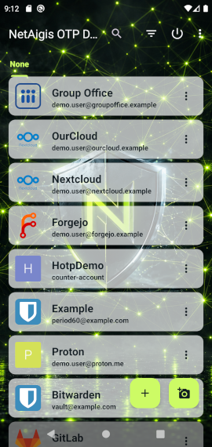
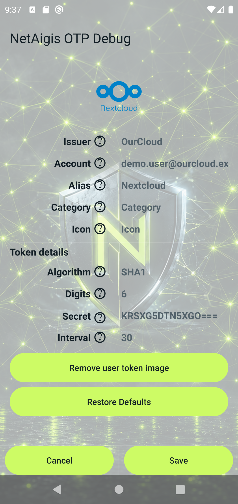
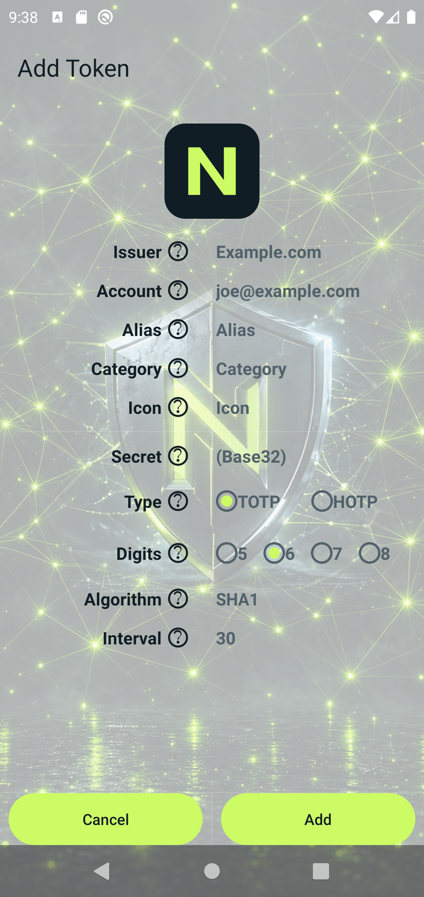

# NetAigis OTP

Android OTP authenticator based on a FreeOTP+ fork, rebranded for NetAigis.

## Support

- [GitHub Sponsors](https://github.com/sponsors/net-aigis?metadata_project=NetAigis-OTP)
- [PayPal](https://www.paypal.com/ncp/payment/FL4HN96RNY5YQ)

## Packages

- Free: `de.wittmer.app.otp.free`
- Pro: `de.wittmer.app.otp` (default flavor)

Features are currently the same for Free and Pro.

## Build

```bash
./gradlew :app:assembleFreeDebug
./gradlew :app:assembleProDebug
```

APKs:

```text
app/build/outputs/apk/free/debug/otp-free-debug.apk
app/build/outputs/apk/pro/debug/otp-debug.apk
```

## Requirements

* Android 6.0+ (minSdk 23)

## Screenshots

<p>





</p>

## Build Dependencies

* Android SDK (minSDK 23)
* Android Studio

## Token list: Alias and icons

- **Alias**: Optional display name in the token list (shown instead of the issuer). Does not affect OTP calculation.
- **Icon**: Optional built-in icon name. Used when no custom token image is set.
- **Automatic thumbnail resolution** (no custom image): **Icon** → **Alias** → **Issuer**. First match wins.

Example: keep issuer `Ourcloud`, set alias `Nextcloud` for the list title and Nextcloud icon; or set **Icon** explicitly when alias/issuer matching is not enough.

## Import Notes

### When importing from JSON.

* Both issuerExt and label are required, if missing the entry will be silently ignored
* secret is required and needs to be an array/list of unsigned char integer values
* tokenOrder is required, any tokens NOT listed will be silently ignored

## Heritage

Originally forked from [FreeOTP+](https://github.com/helloworld1/FreeOTPPlus) / FreeOTP (Red Hat).
See `COPYING` for license details.
